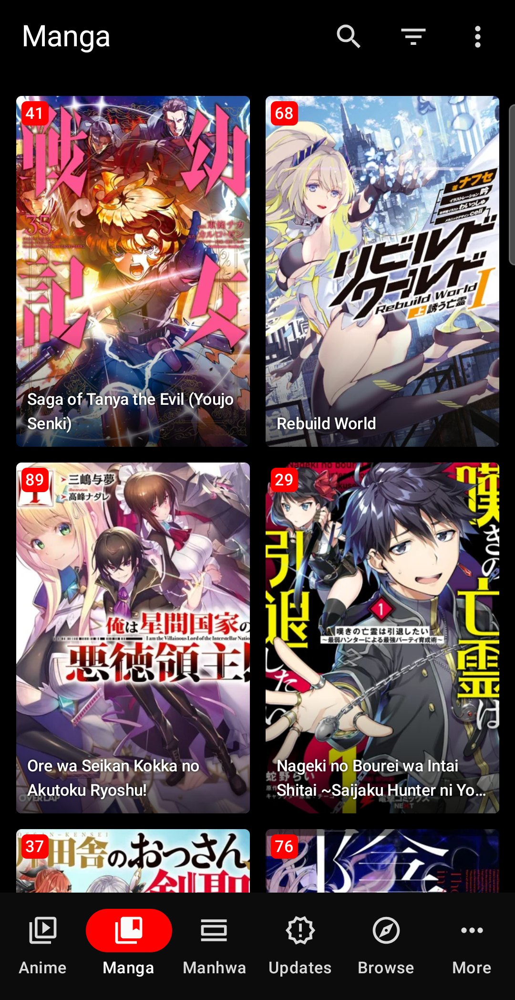

<div align="center">


# Aniyomi Revived

**Watch anime and read manga on Android, with one app and one library.**

An independent fork of [Aniyomi](https://github.com/aniyomiorg/aniyomi), with its own releases, fixes and features.

[](https://github.com/Blackyfi/aniyomi-revived/releases/latest)
[](https://github.com/Blackyfi/aniyomi-revived/releases/latest)
[](https://github.com/Blackyfi/aniyomi-revived/releases)
[](https://github.com/Blackyfi/aniyomi-revived/actions/workflows/build_push.yml)
[](./LICENSE)

[**Download**](#download) · [What's new](#whats-new-in-revived) · [Benchmarks](#benchmarks) · [Features](#features) · [Verify a download](#verify-a-download) · [Changelog](https://github.com/Blackyfi/aniyomi-revived/releases)

&nbsp;&nbsp;
<br>


</div>

---

> [!NOTE]
> **About this fork.** I started Revived in May 2026, when Aniyomi had gone seven months without a release. Since then: **43 releases** and **300+ commits** on speed, battery, security and the features I wanted as a daily user. Everything listed under *What's new* was built here. Issues and pull requests are welcome.
> &nbsp;&nbsp;&nbsp;— [@Blackyfi](https://github.com/Blackyfi)

## What's new in Revived

<table>
<tr>
<td width="50%" valign="top">

### ⚡ Faster and lighter
- Opens without waiting for extensions to load
- Video starts **2 s after the first working host**, instead of waiting for all of them
- Library, Updates and History pause while hidden
- Download worker sleeps when you're offline

</td>
<td width="50%" valign="top">

### 🔒 Safer by default
- Only extensions signed by a repo you added can load
- Backups are restored as untrusted input
- Passwords, tokens and cookies are scrubbed from shared logs
- Every APK is built in CI, attested and scanned

</td>
</tr>
<tr>
<td valign="top">

### 🧲 Torrent streaming
- Stream episodes and read chapters from torrents and magnet links
- Built-in torrent server, with its own settings screen
- Works on networks that block DNS

</td>
<td valign="top">

### 📚 Library that fits how you read
- **Manhwa tab**, sorted automatically from genre and language
- **Switch source per entry** without losing progress
- **Content language**: one setting for manga, anime and subtitles
- Undo from the snackbar

</td>
</tr>
<tr>
<td valign="top">

### 🎬 Player and reader
- Errors stay on screen with Retry / Switch host / WebView
- Next episode is prepared during the last two minutes
- Reader loads two pages at once, preload 2–12 pages

</td>
<td valign="top">

### ⬇️ Downloads and updates
- Parallel downloads, with a speed test to suggest a value
- Auto-download per entry
- Library updates every 6 h, inside a time window you choose
- External downloaders: 1DM, ADM, FluxDown, AB Download Manager

</td>
</tr>
</table>

## Benchmarks

Revived against the latest upstream Aniyomi, on the same phone with the same library.

| | Aniyomi v0.18.2.1 | **Revived v0.18.1.47** | |
|---|--:|--:|---|
| **Cold start** to first frame | 870 ms | **585 ms** | 🟢 **33% faster** |
| **Download size** (arm64 APK) | 83.4 MB | **75.5 MB** | 🟢 **9% smaller** |
| **Memory** after launch | 138 MB | **137 MB** | ⚪ same, while drawing real covers |

<details>
<summary>How this was measured</summary>

Samsung Galaxy S24 Ultra, Android 17, November 2026. Both apps installed side by side with the same library restored from one backup. Cold start is the median of 12 alternating `am start -S -W` launches after a warm-up (Revived 552–602 ms, Aniyomi 852–897 ms: the ranges don't overlap). Memory is total PSS from `dumpsys meminfo`, 8 s after launch on the manga library, median of 3. In that test Aniyomi could not load the covers, so Revived was doing more work. Size is the release APK from each project's GitHub page.
</details>

### Fixed along the way

| | Before | Now |
|---|---|---|
| MyAnimeList search | up to ~100 requests | **1 request** |
| Download progress notifications | one every 50 ms | throttled |
| Cloudflare challenge that needs a click | 30 s timeout | **fails at once** |
| Reader auto background on large scans | full page decode (100 MB+) | **no full decode** |
| Extension update check | every launch | **once a day** |
| Idle torrent server | runs until closed | **stops after 5 min** |
| Splash screen | fixed minimum time | **none** |

## Download

[](https://github.com/Blackyfi/aniyomi-revived/releases/latest)

| APK | For |
|---|---|
| `arm64-v8a` | **Almost every phone from the last 7 years. Pick this one if unsure.** |
| `armeabi-v7a` | Older or low-end 32-bit phones |
| `x86` / `x86_64` | Emulators, some Chromebooks |
| universal | Any device (about 3× larger) |

Requires **Android 8.0+**. Installs alongside other Aniyomi builds (it has its own app ID).

## Features

- **Watch:** mpv-based player with gestures, filters, Lua scripts, picture-in-picture and AniSkip
- **Read:** paged, long-strip and webtoon viewers, with configurable reading direction
- **Track:** MyAnimeList, AniList, Kitsu, MangaUpdates, Shikimori, Simkl, Bangumi
- **Organize:** categories, filters, sorting, and a separate Manhwa tab
- **Offline:** downloads, local content, and backups to any folder or cloud
- **Extensions:** install sources from any repo you add; only signed ones load

## Verify a download

Every release is built by GitHub Actions from this repository, signed with one key, attested, and scanned on VirusTotal. You don't have to take my word for it:

<details>
<summary><b>Check it was built from this source</b></summary>

```sh
gh attestation verify aniyomi-arm64-v8a-vX.Y.Z.apk --repo Blackyfi/aniyomi-revived
```
All attestations: [attestations page](https://github.com/Blackyfi/aniyomi-revived/attestations).
</details>

<details>
<summary><b>Check the signing certificate</b></summary>

SHA-256:
```
6D:16:C0:9F:5D:EB:49:1B:A6:BE:5B:72:5E:15:82:8C:B4:EE:A1:98:A2:9C:DE:9A:45:23:71:36:17:D4:81:EF
```
On Android use [AppVerifier](https://github.com/soupslurpr/AppVerifier); on a computer, `apksigner verify --print-certs <apk>`.
</details>

<details>
<summary><b>About the one VirusTotal flag on x86 / universal builds</b></summary>

The phone builds (arm64-v8a, armeabi-v7a) scan clean. One engine of about 67, Elastic, flags the x86 and universal builds as "Asacub". It's a false positive: the rule is a single 22-byte pattern that matches an ordinary JNI call (`NewGlobalRef`) in the video player library (`lib/x86/libplayer.so`), unchanged since the first release. Reported upstream: [elastic/protections-artifacts#142](https://github.com/elastic/protections-artifacts/issues/142).
</details>

## Contributing

Bug reports and pull requests are welcome. Please read the [contributing guide](./CONTRIBUTING.md) and [code of conduct](./CODE_OF_CONDUCT.md), and open an issue before larger changes. Report bugs in [this repository's issues](https://github.com/Blackyfi/aniyomi-revived/issues), not upstream's.

## Credits

Revived stands on years of work by the [Aniyomi](https://github.com/aniyomiorg/aniyomi/graphs/contributors), [Mihon](https://github.com/mihonapp/mihon) and Tachiyomi contributors, and on [mpv-android](https://github.com/mpv-android/mpv-android). Thank you.

<a href="https://github.com/aniyomiorg/aniyomi/graphs/contributors"></a>

## Disclaimer

This app hosts no content and has no affiliation with any content provider. Sources come from extensions that you choose to install.

<details>
<summary><b>License</b> — Apache 2.0</summary>

```
Copyright © 2015 Javier Tomás
Copyright © 2024 Mihon Open Source Project
Copyright © 2024 Aniyomi Open Source Project
Copyright © 2026 Blackyfi

Licensed under the Apache License, Version 2.0 (the "License");
you may not use this file except in compliance with the License.
You may obtain a copy of the License at

    http://www.apache.org/licenses/LICENSE-2.0

Unless required by applicable law or agreed to in writing, software
distributed under the License is distributed on an "AS IS" BASIS,
WITHOUT WARRANTIES OR CONDITIONS OF ANY KIND, either express or implied.
See the License for the specific language governing permissions and
limitations under the License.
```
</details>
