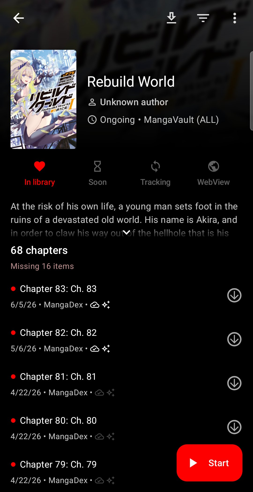
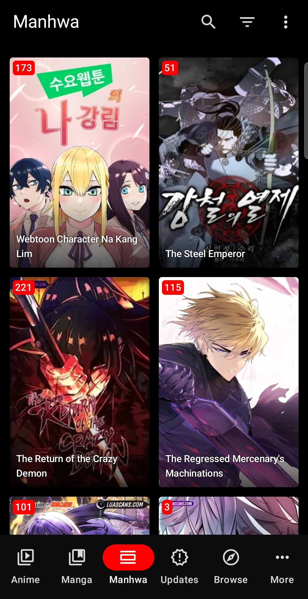
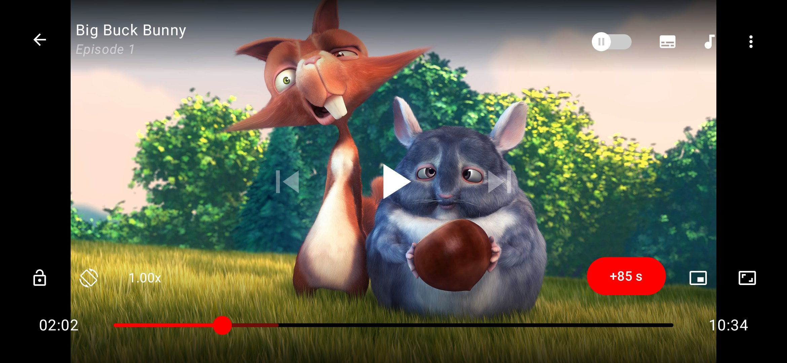

<div align="center">


# Aniyomi Revived

**Watch anime and read manga on Android, with one app and one library.**

An independent fork of [Aniyomi](https://github.com/aniyomiorg/aniyomi), with its own releases, fixes and features.

[](https://github.com/Blackyfi/aniyomi-revived/releases/latest)
[](https://github.com/Blackyfi/aniyomi-revived/releases/latest)
[](https://github.com/Blackyfi/aniyomi-revived/releases)
[](https://github.com/Blackyfi/aniyomi-revived/actions/workflows/build_push.yml)
[](./LICENSE)

[**Download**](#download) · [What's new](#whats-new-in-revived) · [Full feature list](#full-feature-list) · [Benchmarks](#benchmarks) · [Verify a download](#verify-a-download) · [Changelog](https://github.com/Blackyfi/aniyomi-revived/releases)

&nbsp;&nbsp;
<br>


</div>

---

> [!NOTE]
> **About this fork.** I started Revived in May 2026, when Aniyomi had gone seven months without a release. Since then: **44 releases** and **320+ commits** on speed, battery, security and the features I wanted as a daily user. Everything listed under *What's new* was built here. Issues and pull requests are welcome.
> [@Blackyfi](https://github.com/Blackyfi)

## What's new in Revived

<table>
<tr>
<td width="50%" valign="top">

### Faster and lighter
- Opens without waiting for extensions to load
- Video starts **2 s after the first working host**, instead of waiting for all of them
- Library, Updates and History pause while hidden
- Download worker sleeps when you're offline

</td>
<td width="50%" valign="top">

### Safer by default
- Only extensions signed by a repo you added can load
- Backups are restored as untrusted input
- Passwords, tokens and cookies are scrubbed from shared logs
- Every APK is built in CI, attested and scanned

</td>
</tr>
<tr>
<td valign="top">

### Torrent streaming
- Stream episodes and read chapters from torrents and magnet links
- Built-in torrent server, with its own settings screen
- Works on networks that block DNS

</td>
<td valign="top">

### Library that fits how you read
- **Manhwa tab**, sorted automatically from genre and language
- **Switch source per entry** without losing progress
- **Content language**: one setting for manga, anime and subtitles
- Undo from the snackbar

</td>
</tr>
<tr>
<td valign="top">

### Player and reader
- **Hold to speed up**, from 1.5x to 4x
- Errors stay on screen with Retry / Switch host / WebView
- Next episode is prepared during the last two minutes
- Reader loads two pages at once, preload 2 to 12 pages

</td>
<td valign="top">

### Downloads and updates
- Parallel downloads, with a speed test to suggest a value
- Auto-download per entry
- Library updates every 6 h, inside a time window you choose
- External downloaders: 1DM, ADM, FluxDown, AB Download Manager

</td>
</tr>
</table>

## Full feature list

Everything below was added in Revived. For the version each change shipped in, see the [changelog](https://github.com/Blackyfi/aniyomi-revived/releases).

### Player

- **Hold to speed up:** press and hold the video to play it faster, and let go to return to normal. The speed (1.5x to 4x) is set in Settings → Player → Gestures, where the long press can also open the screenshot menu or do nothing.
- **Stays open on errors:** when an episode can't play, the error shows over the player with Retry, Switch host, Open in WebView and Close.
- **Starts sooner:** playback begins 2 seconds after the first usable host instead of waiting for all of them. Waiting for all is still an option.
- **Next episode ready:** with autoplay on Wi-Fi, the next episode's hosts are looked up during the last two minutes.
- **Shows why it's loading:** peers and speed for torrents, cache speed and buffering for everything else.
- **Video cache sized for your device:** refills in bursts and gives up on a stalled connection after 30 seconds.
- **Subtitles follow your content language** when no preferred subtitle language is set.
- Screenshot button in the More menu, and player controls labelled for TalkBack.
- The mpv player library is built by this project.

### Reader

- **Stays open on errors:** a chapter that can't load shows the cause with Retry, Open in WebView and Close.
- **Faster page loading:** two pages load at once and the page on screen goes first. Preload is adjustable from 2 to 12 pages.
- **Retry really retries:** a page that failed to decode is downloaded again.
- **Server status per chapter:** with sources that support it, each chapter row shows whether the server has the pages and whether they've been upscaled.
- Uses less memory on low-memory devices, and picks the automatic background color without decoding the whole page.

### Torrent streaming

- **Watch and read from torrents:** episodes and manga pages from torrent files and magnet links, through a built-in torrent server.
- **Torrent settings screen:** port, trackers, cache size, download folder, seeding and clearing the cache.
- **Works on restricted networks:** `.torrent` files are fetched by the app itself, with its DNS over HTTPS, cookies and Cloudflare handling.
- **Torrent chapters:** pages wait for peers, show the swarm status and load up to three at a time.
- **Locked down:** the server only listens on your device, refuses links to your local network and keeps tracker passkeys out of the logs.
- Runs with a notification, and stops itself after 5 idle minutes.

### Library and browsing

- **Manhwa tab:** entries are sorted into Manga or Manhwa from their genres and language. Manhwa get their own tab in Library, Updates and History, can be the start screen, and keep their type through backups. Change it per entry or for a whole selection with "Set type".
- **Switch source per entry:** for entries offered by several sources, a picker above the chapter list switches source without losing read progress. Other sources are loaded in the background, so switching is instant.
- **Content language:** one setting for manga, anime and subtitles, offered during first setup. Browse tells you when installed sources are hidden by it.
- **Autocomplete in source filters:** tag fields suggest values as you type, with include and exclude.
- **Undo:** marking as read or removing from the library can be undone from the snackbar.
- **Loading placeholders** instead of spinners in the library, Browse and entry details.
- **First-run guidance:** an empty library, Sources tab or extension list explains what to do next.
- **Copy installed extensions:** one button copies the name, language and version of each installed extension, for bug reports or a new device.
- Covers, badges and download states are described for screen readers.

### Downloads and updates

- **Parallel downloads** that really use the number you set, with a speed test that suggests a value.
- **Auto-download per entry:** turn automatic downloads on or off for a single entry.
- **Update schedule:** a 6-hour interval and an update time window in the time zone of your choice. An update that falls outside the window runs once it opens.
- **External downloaders:** 1DM, ADM, FluxDown and AB Download Manager. Headers and cookies are passed along, HLS streams are sent as HLS, and the episode folder is copied to your clipboard.
- **Clear feedback:** queuing from a selection says how many were added, failed downloads are marked in the queue, and entries skipped by update restrictions are reported with the reason.
- Downloads stay tied to the source they were queued from, and new episodes found by a library update are actually queued.

### Security and privacy

- **Only trusted extensions load:** an extension must be signed by the key of a repo you added. The project's repo comes pre-added, and a broken or unsigned extension can no longer crash the app.
- **Backups are treated as untrusted:** a restore only brings back your settings and per-source preferences, extension repos must use HTTPS and a signing fingerprint, player scripts need your approval, and crafted or oversized archives are rejected.
- **Safer tracker logins:** sign-ins are checked against the request you started, and MyAnimeList uses PKCE.
- **WebView:** can't read local files, and a source's headers are only sent to its own site.
- **Private logs:** passwords, tokens and cookies are removed before logs are shared.
- **Locked-down app:** release builds trust only system certificates, app data is left out of device-to-device transfer, and other apps can't start a restore through crafted links.
- **Its own app ID**, so it installs next to other Aniyomi builds.
- **Verifiable releases:** every APK is built in CI, attested and scanned on VirusTotal ([details](#verify-a-download)).

### Speed and battery

- **Faster startup:** extensions are scanned in the background, heavy setup waits until after the first frame, and the minimum splash screen time is gone.
- **Nothing runs when you can't see it:** Library, Updates and History pause while hidden, widgets only refresh when one is placed, and the download worker sleeps when you're offline.
- **Smoother library:** new database indexes, no full redraw when sorting or filtering, and fast select-all in large categories.
- **Fewer requests:** extension updates are checked once a day, and MyAnimeList search uses one request.
- **Smaller download:** only the languages the app is translated into are included.

### Troubleshooting

- **Readable errors:** timeouts, refused connections, TLS failures, rate limits and server errors are explained in plain words, with a next step.
- **Debug logs screen** under Settings → Advanced, with search, level filter, copy and share. Errors are kept even with verbose logging off, along with why the app last closed (Android 11+).
- **Extension error log:** each extension error is saved with the entry or search it came from.
- **Cloudflare detection:** real challenges are recognised, and ones that need a click fail at once instead of after 30 seconds.

### For extension authors

- `AnimeFilter.AutoComplete` / `Filter.AutoComplete` for tag inputs with suggestions.
- `MultiSourceCatalogSource` for entries backed by several sources, with the in-app source picker.
- `ChapterPipelineSource` to show server-side chapter status.
- Torrent support: sources can return magnet or torrent links and read torrent files directly.
- `chapterPageParse` is optional, so sources written for upstream compile as they are.

## Benchmarks

Revived against the latest upstream Aniyomi, on the same phone with the same library.

| | Aniyomi v0.18.2.1 | **Revived v0.18.1.47** | |
|---|--:|--:|---|
| **Cold start** to first frame | 870 ms | **585 ms** | **33% faster** |
| **Download size** (arm64 APK) | 83.4 MB | **75.5 MB** | **9% smaller** |
| **Memory** after launch | 138 MB | **137 MB** | same, while drawing real covers |

<details>
<summary>How this was measured</summary>

Samsung Galaxy S24 Ultra, Android 17, November 2026. Both apps installed side by side with the same library restored from one backup. Cold start is the median of 12 alternating `am start -S -W` launches after a warm-up (Revived 552–602 ms, Aniyomi 852–897 ms: the ranges don't overlap). Memory is total PSS from `dumpsys meminfo`, 8 s after launch on the manga library, median of 3. In that test Aniyomi could not load the covers, so Revived was doing more work. Size is the release APK from each project's GitHub page.
</details>

### Fixed along the way

| | Before | Now |
|---|---|---|
| MyAnimeList search | up to ~100 requests | **1 request** |
| Download progress notifications | one every 50 ms | throttled |
| Cloudflare challenge that needs a click | 30 s timeout | **fails at once** |
| Reader auto background on large scans | full page decode (100 MB+) | **no full decode** |
| Extension update check | every launch | **once a day** |
| Idle torrent server | runs until closed | **stops after 5 min** |
| Splash screen | fixed minimum time | **none** |

## Download

[](https://github.com/Blackyfi/aniyomi-revived/releases/latest)

| APK | For |
|---|---|
| `arm64-v8a` | **Almost every phone from the last 7 years. Pick this one if unsure.** |
| `armeabi-v7a` | Older or low-end 32-bit phones |
| `x86` / `x86_64` | Emulators, some Chromebooks |
| universal | Any device (about 3× larger) |

Requires **Android 8.0+**. Installs alongside other Aniyomi builds (it has its own app ID).

## Features from Aniyomi

Everything you know from Aniyomi is still here:

- **Watch:** mpv-based player with gestures, filters, Lua scripts, picture-in-picture and AniSkip
- **Read:** paged, long-strip and webtoon viewers, with configurable reading direction
- **Track:** MyAnimeList, AniList, Kitsu, MangaUpdates, Shikimori, Simkl, Bangumi
- **Organize:** categories, filters, sorting, and a separate Manhwa tab
- **Offline:** downloads, local content, and backups to any folder or cloud
- **Extensions:** install sources from any repo you add; only signed ones load

## Verify a download

Every release is built by GitHub Actions from this repository, signed with one key, attested, and scanned on VirusTotal. You don't have to take my word for it:

<details>
<summary><b>Check it was built from this source</b></summary>

```sh
gh attestation verify aniyomi-arm64-v8a-vX.Y.Z.apk --repo Blackyfi/aniyomi-revived
```
All attestations: [attestations page](https://github.com/Blackyfi/aniyomi-revived/attestations).
</details>

<details>
<summary><b>Check the signing certificate</b></summary>

SHA-256:
```
6D:16:C0:9F:5D:EB:49:1B:A6:BE:5B:72:5E:15:82:8C:B4:EE:A1:98:A2:9C:DE:9A:45:23:71:36:17:D4:81:EF
```
On Android use [AppVerifier](https://github.com/soupslurpr/AppVerifier); on a computer, `apksigner verify --print-certs <apk>`.
</details>

<details>
<summary><b>About the one VirusTotal flag on x86 / universal builds</b></summary>

The phone builds (arm64-v8a, armeabi-v7a) scan clean. One engine of about 67, Elastic, flags the x86 and universal builds as "Asacub". It's a false positive: the rule is a single 22-byte pattern that matches an ordinary JNI call (`NewGlobalRef`) in the video player library (`lib/x86/libplayer.so`), unchanged since the first release. Reported upstream: [elastic/protections-artifacts#142](https://github.com/elastic/protections-artifacts/issues/142).
</details>

## Contributing

Bug reports and pull requests are welcome. Please read the [contributing guide](./CONTRIBUTING.md) and [code of conduct](./CODE_OF_CONDUCT.md), and open an issue before larger changes. Report bugs in [this repository's issues](https://github.com/Blackyfi/aniyomi-revived/issues), not upstream's.

## Credits

Revived stands on years of work by the [Aniyomi](https://github.com/aniyomiorg/aniyomi/graphs/contributors), [Mihon](https://github.com/mihonapp/mihon) and Tachiyomi contributors, and on [mpv-android](https://github.com/mpv-android/mpv-android). Thank you.

<a href="https://github.com/aniyomiorg/aniyomi/graphs/contributors"></a>

## Disclaimer

This app hosts no content and has no affiliation with any content provider. Sources come from extensions that you choose to install.

<details>
<summary><b>License</b> (Apache 2.0)</summary>

```
Copyright © 2015 Javier Tomás
Copyright © 2024 Mihon Open Source Project
Copyright © 2024 Aniyomi Open Source Project
Copyright © 2026 Blackyfi

Licensed under the Apache License, Version 2.0 (the "License");
you may not use this file except in compliance with the License.
You may obtain a copy of the License at

    http://www.apache.org/licenses/LICENSE-2.0

Unless required by applicable law or agreed to in writing, software
distributed under the License is distributed on an "AS IS" BASIS,
WITHOUT WARRANTIES OR CONDITIONS OF ANY KIND, either express or implied.
See the License for the specific language governing permissions and
limitations under the License.
```
</details>
